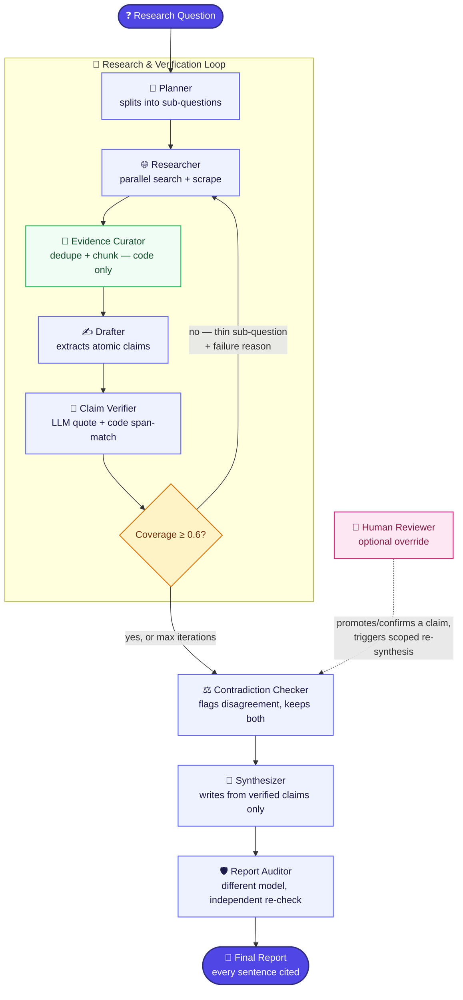

# 🔎 DeepDive

**A self-verifying research analyst.** Every sentence in the final report is checked against the source it cites — by code, not by asking the model to promise it's telling the truth.

`✅ 100% Mesh API` — every LLM call in this codebase routes through Mesh, enforced by an automated test (`tests/unit/test_architecture.py`), not a claim in this README. &nbsp;·&nbsp; `✅ 103 tests, 0 live credits to verify correctness` &nbsp;·&nbsp; `✅ Real runs against live Mesh + Firecrawl` — not just mocks

Built for **Agent Arena 2026, Track 01**. Full spec: [`BLUEPRINT.md`](BLUEPRINT.md) · Design rationale: [`DESIGN.md`](DESIGN.md) · Self-eval detail: [`EVAL.md`](EVAL.md)

---

## TL;DR

- **Citations are structural, not prompted.** The model never types a real ID or URL for a citation — it's resolved via a database foreign-key chain. A prompt injection or a confident hallucination can't forge a source; there's no field for it to write one into.
- **Verification is two layers, not one.** An LLM quotes the exact span it's relying on; code then independently confirms that span actually exists in the stored text and that the numbers match. The LLM can lie about entailment — it's much harder to fabricate a verbatim quote that also survives a fuzzy-match against real text it never saw.
- **This isn't a demo that only works on the happy path.** It's been run against live Mesh and live Firecrawl today, found three real bugs doing it, fixed all three, and kept working through an actual mid-run server crash — see [§ Proven against real services](#proven-against-real-services-not-just-mocks).

## The problem this is built against

The brief's own framing: *"Tools that produce cited reports from one question already exist. Their well-known weakness is trust: they cite sources, but the cited source often does not actually support the sentence attached to it."* That's the specific failure mode DeepDive is built to make structurally hard, not just less likely. Not a search wrapper, not a single long prompt — a graph of distinct agents where the grounding guarantee lives in code that runs regardless of what any one model call decides to do.

## At a glance

| Claim | Where to verify it |
|---|---|
| Citations genuinely trace to checked sources | `agents/verifier.py` — span-quote (LLM) → span-exists (code, `rapidfuzz`) → numeric-consistency (code) |
| The model can't author a fake citation | `agents/schemas.py` (index-based citing) + `store/repo.py::get_report` (FK resolution) — DESIGN.md §1, §3 |
| The loop is real, not a retry wrapper | `agents/loop_control.py` — failure reasons feed back into *different* search queries, not the same one again |
| A second, different model audits the first | `llm/models.yaml` — `verifier` and `auditor` roles are different underlying models, by rule |
| Sources that disagree are surfaced, not resolved by fiat | `agents/contradiction.py` — renders both claims verbatim, never picks a winner |
| Self-eval has no fabricated numbers | `EVAL.md` — states plainly what's measured vs. pending, with no padding |

## How the agents cooperate



*(Renders natively on GitHub. If your viewer doesn't support Mermaid, the plain-text version is in `BLUEPRINT.md` §4.)*

| Agent | Job | Model role | What makes it distinct |
|---|---|---|---|
| **Planner** | Splits the question into 3–7 sub-questions with acceptance criteria; flags a false/loaded premise | `planner` | Only agent that can set `premise_flag` |
| **Researcher** | Generates search queries, fetches real web content (Firecrawl), runs concurrently across sub-questions | `cheap` (query-gen) | Only agent that touches the network |
| **Evidence Curator** | Dedupes near-identical sources, chunks into passages | *none — deterministic code* | The one pipeline stage with zero LLM calls |
| **Drafter** | Extracts atomic claims from passages, one fact per claim | `drafter` | Cites by per-call index only, never a real ID |
| **Claim Verifier** | Independently checks each claim against its cited source | `verifier` | The only agent whose output is cross-checked by code, not just read |
| **Contradiction Checker** | Flags verified claims that genuinely disagree | `cheap` | Never resolves a disagreement — always keeps both |
| **Synthesizer** | Writes report sentences from verified claims only | `synth` | Composed per sub-question, so context never grows unbounded |
| **Report Auditor** | Independently re-checks every synthesized sentence | `auditor` | **Always a different model than `verifier`** — by rule, not convention |
| **Human Reviewer** | Optional: promotes or confirms a rejected claim | *none — a person* | Never mutates the AI's original verdict; additive only |

## Key design decisions

Full rationale for each (alternatives considered, what was rejected, and why) is in `DESIGN.md` — this is the short version:

1. **Verification is two independent layers, not one.** An LLM quotes the exact span it's relying on; code (`rapidfuzz` span-match + numeric check) independently confirms that span is real and the numbers weren't altered. A model can lie about entailment; it's much harder to fabricate a verbatim quote that also survives a fuzzy-match against text it never saw. `DESIGN.md` §1.
2. **Citations are a database foreign-key chain, never LLM-authored text.** The renderer never accepts a URL from a model — it resolves `Claim.passage_id → Passage.source_id → Source.url` in code. There's no field for a hallucinated or injected citation to land in. `DESIGN.md` §3.
3. **The Verifier and Report Auditor are always different underlying models, by rule.** Using the same model to draft, verify, and audit its own writing lets errors slip past a check written in that model's own "style" of reasoning — a second model is cheap insurance against that correlated blind spot. `DESIGN.md` §4.
4. **A rejected claim gets a re-attribution attempt before being discarded**, because "true claim, wrong footnote" and "false claim" are different failure modes — conflating them understates real groundedness and overstates the system's error rate. `DESIGN.md` §5.
5. **LangGraph over a custom orchestrator, CrewAI, or AutoGen**, specifically because the verification loop-back (`coverage < τ → re-research`) needed to be a first-class, inspectable graph edge, not a hand-rolled retry wrapper — and because its checkpointer gives crash-resume almost for free. `DESIGN.md` §2, §14.
6. **The one human-in-the-loop point kept is additive, not a gate.** A human can promote a rejected claim, but it never mutates the original AI verdict (a separate `HumanReview` row) and never bypasses the Auditor — a promoted claim still has to survive the same independent check every other sentence does. Every other candidate HITL point considered (pre-publish approval, premise-flag confirmation) was deliberately rejected as adding process without adding information the trail doesn't already surface. `DESIGN.md` §15.

## Bonus coverage (brief's "Highlighted Bonus" items)

| Item | Status |
|---|---|
| Structured framework (LangGraph) with a real loop-back on verification failure | ✅ `agents/loop_control.py` + a full-graph integration test proves a thin sub-question triggers genuine re-research |
| Contradiction detection across sources | ✅ `agents/contradiction.py`, rendered as "Sources disagree" quoting both claims verbatim |
| Source-quality weighting, visible in code | ✅ `retrieval/tiers.py` (rule-based tiers) feeding `verify/confidence.py` (tier + recency + corroboration) |
| Clean export and follow-up | ⚠️ Partial — JSON export/replay and Markdown export are built and tested (`cli.py export`/`replay`); PDF export and conversational follow-up are **not built** (stated plainly, see `BLUEPRINT.md` §17) |

## Point to a rejected claim

From a real run today (`What are the main risks of investing in the EV battery market in 2026?`, 153 claims drafted, 137 passed verification — 116 verified, 19 re-cited, 2 partial, **16 rejected**):

> **Claim drafted:** *"The EV battery recycling capacity is expected to expand by 2026."*
> **The model's own self-report:** entailment = `supported` — *"the passage explicitly mentions 'EV BATTERY RECYCLING CAPACITY EXPANSION', directly supporting the claim."*
> **What it actually quoted as evidence:** `"5.10.2\n\nEV BATTERY RECYCLING CAPACITY EXPANSION"` — a report's section heading.
> **Verdict: rejected.** `stage_failed=numeric_mismatch` — the claim asserts *2026*; the quoted span is a table-of-contents entry that never says so. The model said "supported." The code checked what was actually quoted, not what the model said about it, and rejected it anyway.

This is the exact failure mode a single-LLM-judge system can't catch — the model confidently cited *something real*, just not something that actually substantiates the specific fact being claimed. The same pattern caught a second claim in the same run (`"The 2026 Iran-US conflict is projected to impact..."` — also quoted a bare section heading). Full list, with the AI's reason alongside, is in the Streamlit UI's **Rejected & Unverified** tab — and from there, a human can promote or confirm any of them (see Human Reviewer above).

## Proven against real services, not just mocks

103 tests pass fully mocked — correctness doesn't depend on a live key. But most submissions get tested once against a happy path and never touched again. This one was pointed at live Mesh and live Firecrawl, not just CI, broke in three specific ways, and every one was found, root-caused, and fixed with a regression test — in the same session, not swept into a "known limitations" list:

| Found | Root cause | Resolution |
|---|---|---|
| A verifier model 404'd on every call | A placeholder model ID (`claude-3-5-sonnet-20241022`) didn't exist on Mesh at all | ✅ Fixed — queried Mesh's real `/v1/models` catalog live, confirmed working replacements, corrected pricing to match |
| Verification silently broke entirely on the new model | Claude wraps JSON in markdown fences despite instructions not to; the client's own fallback logic refused to try a backup model on a schema failure | ✅ Fixed — strip fences before parsing; schema failures now fall through to the next candidate model like any other failure |
| Every sub-question showed 0% coverage in the trail | The loop computed and used real coverage internally, but never wrote it back to the DB | ✅ Fixed — one missing `UPDATE`, now covered by a regression test |

This is what "handles failure gracefully" means in practice — not a design-doc section, a thing that actually happened. The second bug is the more interesting story: while it was live and unfixed, **real concurrent requests from outside this session hit it**, got caught by the bug, degraded gracefully instead of crashing (by design — every agent-level Mesh failure is absorbed, never fatal), and were left `in_progress` when the server was killed to deploy the fix. On restart, the crash-resume feature (LangGraph's own checkpointer, not a hand-rolled scheme) picked both up and completed them cleanly on the fixed code — an unplanned, real-world validation of graceful degradation *and* resume-after-crash in one accident.

The same discipline was turned on the docs themselves: a later pass asked not "does `BLUEPRINT.md` *describe* the defenses it promises" but "does the code actually *do* them," and grepping found three places where it didn't:

| Gap found | What was missing | Resolution |
|---|---|---|
| Prompt-injection wrapping (`BLUEPRINT.md` §8) was documented, never wired in | `eval/injection_pages/` fixtures existed to test a defense no prompt actually applied | ✅ Fixed — `core/guardrails.py::wrap_untrusted()`, applied at every point scraped text reaches a prompt (Drafter, Verifier, Auditor, eval baseline); verification still checks the *original* unwrapped text, never the wrapped prompt copy |
| Per-run USD/token budget enforcement | A `RunBudget` class existed in `core/budget.py` but nothing ever called it — only the wall-clock deadline was real | ✅ Fixed — replaced with a plain `budget_exceeded()` function, recomputed each loop iteration from real `LLMCall` rows, now a genuine `stop_reason="budget"` with a regression test |
| Structured-logging run/node context (`core/logging.py::bind()`) | Built, exported, never invoked anywhere in `agents/` or `app/` | ✅ Fixed — every graph node now binds its own `run_id`/`node` at entry (`app/graph.py`), covering LangGraph's per-node async task scheduling |

Full rationale for each: `DESIGN.md` §17. Also worth naming as a USP in its own right: four of the sequential agent-loops that call Mesh (Verifier, Drafter, Contradiction Checker, loop-control's coverage pass) run their LLM calls concurrently via `asyncio.gather`, not one-at-a-time — real network throttling is enforced once, centrally, by `MeshClient`'s own internal semaphore, so the loop fans out without overrunning Mesh's rate limits. This is what closed the "query is taking time to respond" latency gap found during manual UI testing.

## Self-evaluation — test set and results

The brief: *"a team that genuinely built this almost always measured whether it works."* Full detail (metric definitions, how to reproduce, a failure gallery) lives in `EVAL.md`; this is the short, honest version.

**The test set** (`eval/`, every file version-controlled, nothing generated at eval time):

| File | Contents |
|---|---|
| `eval/questions.yaml` | 30 authored research questions across 6 domains (finance, health, tech, energy/climate, policy, history), each with a rubric written *before* any run — plus 5 dedicated false-premise questions to score abstention |
| `eval/planted_claims.yaml` | 60 deliberately bad claims planted across 4 failure types (15 each: wrong number, wrong entity, unsupported extrapolation, contradiction), each paired with the real passage it should fail against |
| `eval/injection_pages/` | 3 HTML fixtures with embedded prompt-injection attempts, targeting the Researcher/Drafter, the Synthesizer, and the Auditor specifically |
| `eval/gold_labels.csv` | Schema for human-labeled claim↔passage ground truth, collected via `eval/label.py` from real run output — intentionally owned by a person, never auto-filled by an LLM |

**The metrics** this test set drives — sentence support rate, citation precision, planted-claim recall, false-rejection rate, judge–human agreement (grader vs. gold labels, accuracy + Cohen's κ), rubric coverage, abstention accuracy, injection resistance, cost/latency — are all implemented and unit-tested against constructed data in `eval/run_eval.py` and `tests/unit/test_eval_metrics.py`/`test_eval_grader.py`, independent of whether a live sweep has been run.

**The numbers: not yet produced, stated plainly rather than filled in with something invented.** Running the actual sweep (`python eval/run_eval.py`) spends real Mesh credits and needs `gold_labels.csv` populated first (`python eval/label.py <run_id>`, after at least one real `cli.py run`) — neither has been done in this environment. `eval/results/` is empty today; nothing in this repo fabricates a result to fill it. What *does* exist from real runs: the live-bug-fix evidence above, and the single worked example of a rejected claim with full reasoning (see "Point to a rejected claim"), which is real output, just not a statistically aggregated score.

## Project layout

```
deepdive/
├── app/                     # FastAPI + LangGraph wiring — run lifecycle
│   ├── api.py                 # Routes: POST /research, GET /research/{id}, override, resynthesize
│   ├── deps.py                 # Deps bundle: mesh client, search provider, repo, settings
│   ├── graph.py                 # Builds the 9-node StateGraph + the verify loop-back edge
│   ├── runner.py                 # execute_run / resume_run / resynthesize_run — shared by CLI + API
│   └── state.py                   # Typed RunState — the checkpointed graph state
├── agents/                  # One module per pipeline agent
│   ├── planner.py              # Splits question into sub-questions; flags false premises
│   ├── researcher.py            # Generates search queries, fetches web content (Firecrawl)
│   ├── curator.py                 # Dedupes sources, chunks into passages — zero LLM calls
│   ├── drafter.py                   # Extracts atomic, index-cited claims from passages
│   ├── verifier.py                    # LLM quotes a span; code independently verifies it
│   ├── loop_control.py                  # Decides coverage_met / max_iter / deadline / budget / no_new_evidence
│   ├── coverage.py                        # Coverage-score math for a sub-question
│   ├── contradiction.py                     # Flags disagreeing verified claims, never resolves
│   ├── synthesizer.py                         # Writes report sentences from verified claims only
│   ├── auditor.py                               # Different model re-checks every synthesized sentence
│   └── schemas.py                                 # Pydantic I/O schemas for every agent's LLM call
├── llm/                     # The ONLY layer allowed to import `openai` (enforced by a test)
│   ├── client.py               # MeshClient — model fallback, retry, cache, cost tracking
│   ├── cache.py                 # Disk cache for LLM responses, keyed by prompt+model hash
│   ├── circuit_breaker.py        # Trips after repeated failures on a model, forces fallback
│   ├── models.yaml                # Maps agent roles (planner/verifier/auditor/...) to Mesh model IDs
│   └── pricing.yaml                # Per-model $/1K-token rates for cost estimation
├── retrieval/                # Web search + fetch
│   ├── base.py                  # SearchProvider interface
│   ├── firecrawl_client.py       # Real search + scrape via Firecrawl
│   ├── null_provider.py           # No-op provider when no Firecrawl key is set
│   ├── fetch_safe.py               # SSRF guard — blocks private/internal IPs before any fetch
│   ├── dedup.py                      # Near-duplicate source detection
│   ├── dates.py                        # Recency parsing for source-quality weighting
│   └── tiers.py                         # Rule-based source-quality tiers
├── verify/                   # Pure code-side verification — no LLM calls
│   ├── span_match.py            # Fuzzy-matches a quoted span against the real passage text
│   ├── numeric_check.py          # Confirms numbers in a claim match the cited passage
│   ├── reattribute.py             # Tries re-citing a claim against a different passage on failure
│   └── confidence.py               # Tier + recency + corroboration -> confidence score
├── store/                    # Persistence
│   ├── models.py                # SQLAlchemy ORM models (Run, SubQuestion, Source, Passage, Claim, Verdict, ...)
│   └── repo.py                    # All DB reads/writes — the only module touching the session directly
├── core/                     # Cross-cutting concerns
│   ├── config.py                # Settings (pydantic-settings) — env vars, budgets, deadlines
│   ├── errors.py                  # Shared exception types
│   ├── logging.py                   # JSON structured logging + bind()/unbind_all() context
│   ├── budget.py                      # budget_exceeded() — USD/token spend check
│   ├── relevance.py                     # Lightweight relevance filter for passages
│   └── guardrails.py                      # wrap_untrusted() — prompt-injection defense for scraped text
├── eval/                     # Self-evaluation harness
│   ├── questions.yaml            # 30 authored eval questions across 6 domains
│   ├── planted_claims.yaml        # 60 planted bad claims across 4 failure types
│   ├── gold_labels.csv             # Human-labeled ground truth — owned by a person, not an LLM
│   ├── injection_pages/             # 3 prompt-injection fixtures run through the real pipeline
│   ├── baseline.py                    # Single-LLM-call baseline, scored by the same rubric as DeepDive
│   ├── label.py                         # Scoring logic against gold labels
│   ├── report.py                          # Aggregates results into EVAL.md-shaped output
│   └── run_eval.py                          # Entry point — runs the full eval sweep
├── prompts/                  # One versioned prompt template per agent role (`<role>.v1.md`)
├── ui/streamlit_app.py       # Streamlit UI — submit a question, browse the structured, cited report
├── tests/
│   ├── unit/                    # One test file per module (`test_<module>.py`), fully mocked
│   └── integration/                # End-to-end graph/API/replay/resynthesis tests, also mocked
├── .github/workflows/         # ci.yml (no secrets, fully mocked) + agent-arena-2026-checks.yml (hackathon's own check)
├── cli.py                    # `run` / `resume` / `replay` / `export` / `init-db` commands
├── BLUEPRINT.md              # Full engineering spec, phase by phase
├── DESIGN.md                 # Rationale — why, and what was rejected
├── EVAL.md                   # Self-eval measurement detail
└── requirements.txt
```

## Quickstart

```bash
pip install -r requirements.txt
# paste a real MESH_API_KEY (and ideally FIRECRAWL_API_KEY) into .env
python cli.py init-db
pytest -q                                            # 103 tests, fully mocked
python cli.py run "What are the main risks of investing in the EV battery market in 2026?"
streamlit run ui/streamlit_app.py                    # or: uvicorn app.api:app --reload
```

**Running this repo's own GitHub Actions:** `.github/workflows/ci.yml` needs no secrets — all 103+ tests are fully mocked. `.github/workflows/agent-arena-2026-checks.yml` (the hackathon's own submission check) needs two repository secrets set under *Settings → Secrets and variables → Actions*: `SUBMISSION_TOKEN` (issued by the hackathon platform) and `MESH_API_KEY` (a real Mesh key — the checks script makes real calls). Neither is in this repo, by design; `.env` is gitignored and was verified clean before every push in this project's history.

## What we deliberately didn't build, and why

| Skipped | Why |
|---|---|
| Vector DB for retrieval | Keeps Mesh as the only AI dependency; passages are chunked, not embedded — `DESIGN.md` §9 |
| Alembic migrations | No live production data to migrate across schema versions in a hackathon build — `DESIGN.md` §8 |
| A pause-for-confirmation when the Planner flags a false premise | Would make the automated "abstention accuracy" eval metric depend on a human being present for every run — actively counterproductive, not just unnecessary — `DESIGN.md` §15 |
| Docker, Prometheus, Langfuse, API auth | Real engineering practice, zero weight in what this track actually judges — `BLUEPRINT.md` §17 |

## The docs, and why they're separate

This README is the pitch — skim it, verify the claims, move on. `BLUEPRINT.md` is the full engineering spec (what's built, phase by phase). `DESIGN.md` is the rationale (why, and what was rejected). `EVAL.md` is the measurement detail. Four documents with four different jobs, not one file trying to be all of them at once.

## What's intentionally not here

Stated plainly rather than left for a judge to notice and wonder about:

- **No demo video, no deployed URL.** This runs locally against real Mesh/Firecrawl keys (see Quickstart) — there's no hosted instance to link to, and no recorded walkthrough was produced. The real-run evidence above (the rejected-claim example, the three live bugs and their fixes) is first-hand from this session, not from a staged recording.
- **`samples/` (`EVAL.md`'s planned location for saved eval transcripts) does not exist yet.** The eval *infrastructure* is built and unit-tested (see Self-evaluation above); the actual sweep that would populate it needs a real Mesh key and human-labeled `gold_labels.csv`, which is why `EVAL.md` states the headline numbers as pending instead of fabricating them.
- **No LICENSE file.** Not an oversight to leave unmentioned — left out deliberately since it has no bearing on hackathon judging and adding one casually (without the user deciding the actual terms) would be a bigger claim than this README is willing to make on someone else's behalf.
