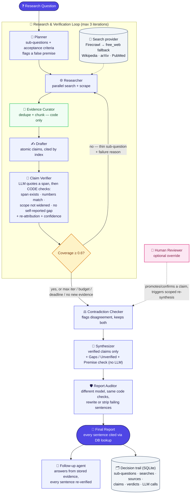

<div align="center">

# 🔎 DeepDive

### A self-verifying research analyst

**Every sentence in the final report is checked against the source it cites — by code, not by asking the model to promise it's telling the truth.**

<br/>


<br/>

🎥 [**Demo video**](https://www.youtube.com/watch?v=yvRKvqpDM24) &nbsp;·&nbsp; 📐 [`BLUEPRINT.md`](BLUEPRINT.md) *(full spec)* &nbsp;·&nbsp; 🧭 [`DESIGN.md`](DESIGN.md) *(design rationale)* &nbsp;·&nbsp; 📊 [`EVAL.md`](EVAL.md) *(self-eval detail)*

Built for **Agent Arena 2026, Track 01**.

</div>

<br/>

| ✅ **100% Mesh API** | ✅ **144 tests, 0 live credits to verify correctness** | ✅ **Real runs against live Mesh + Firecrawl** |
|:---:|:---:|:---:|
| Every LLM call in this codebase routes through Mesh, enforced by an automated test (`tests/unit/test_architecture.py`), not a claim in this README. | Fully mocked suite — correctness doesn't depend on a live key. | Not just mocks. |

<br/>

### 🏆 Scoreboard

*(every figure below is detailed, with caveats, in [Self-evaluation](#self-evaluation) and [`EVAL.md`](EVAL.md))*

| 🎯 Planted bad claims rejected | 🛡️ Injection attacks followed | 🔬 Independent-grader support (strict) | 📋 Rubric coverage | 🧪 Tests |
|:---:|:---:|:---:|:---:|:---:|
| **60 / 60** | **0 / 3** | **200 / 207 = 0.97** | **0.84** | **144** |

<br/>

<details open>
<summary><b>📑 Contents</b></summary>

- [TL;DR](#tldr)
- [The problem this is built against](#the-problem-this-is-built-against)
- [At a glance](#at-a-glance)
- [How the agents cooperate](#how-the-agents-cooperate)
- [Key design decisions](#key-design-decisions)
- [Bonus coverage](#bonus-coverage)
- [Point to a rejected claim](#point-to-a-rejected-claim)
- [Proven against real services, not just mocks](#proven-against-real-services)
- [Self-evaluation — test set and results](#self-evaluation)
- [Project layout](#project-layout)
- [Quickstart](#quickstart)
- [Scope freeze](#scope-freeze)
- [What we deliberately didn't build, and why](#what-we-deliberately-didnt-build)
- [The docs, and why they're separate](#the-docs)
- [What's intentionally not here](#whats-intentionally-not-here)

</details>

---

<a id="tldr"></a>

## ⚡ TL;DR

- **Citations are structural, not prompted.** The model never types a real ID or URL for a citation — it's resolved via a database foreign-key chain. A prompt injection or a confident hallucination can't forge a source; there's no field for it to write one into.
- **Verification is two layers, not one.** An LLM quotes the exact span it's relying on; code then independently confirms that span actually exists in the stored text and that the numbers match. The LLM can lie about entailment — it's much harder to fabricate a verbatim quote that also survives a fuzzy-match against real text it never saw.
- **This isn't a demo that only works on the happy path.** It's been run against live Mesh and live Firecrawl today, found three real bugs doing it, fixed all three, and kept working through an actual mid-run server crash — see [§ Proven against real services](#proven-against-real-services).

---

<a id="the-problem-this-is-built-against"></a>

## 🎯 The problem this is built against

> The brief's own framing: *"Tools that produce cited reports from one question already exist. Their well-known weakness is trust: they cite sources, but the cited source often does not actually support the sentence attached to it."*

That's the specific failure mode DeepDive is built to make structurally hard, not just less likely. Not a search wrapper, not a single long prompt — a graph of distinct agents where the grounding guarantee lives in code that runs regardless of what any one model call decides to do.

---

<a id="at-a-glance"></a>

## 👀 At a glance

| Claim | Where to verify it |
|---|---|
| Citations genuinely trace to checked sources | `agents/verifier.py` — span-quote (LLM) → span-exists (code, `rapidfuzz`) → numeric-consistency (code) |
| The model can't author a fake citation | `agents/schemas.py` (index-based citing) + `store/repo.py::get_report` (FK resolution) — DESIGN.md §1, §3 |
| The loop is real, not a retry wrapper | `agents/loop_control.py` — failure reasons feed back into *different* search queries, not the same one again |
| A second, different model audits the first | `llm/models.yaml` — `verifier`, `auditor` and the eval `grader` share **no** model, primary or fallback; enforced by `tests/unit/test_model_roles.py` |
| Sources that disagree are surfaced, not resolved by fiat | `agents/contradiction.py` — renders both claims verbatim, never picks a winner |
| Self-eval has no fabricated numbers | `EVAL.md` + `eval/results/*.json` — real numbers where measured, "not measured" where not |
| Report says what it could not verify | `agents/synthesizer.py::build_gaps_sentences` — deterministic "Gaps / Unverified" section, no LLM |

---

<a id="how-the-agents-cooperate"></a>

## 🤝 How the agents cooperate



<sub>*(Renders natively on GitHub. If your viewer doesn't support Mermaid, the plain-text version is in `BLUEPRINT.md` §4.)*</sub>

<br/>

| Agent | Job | Model role | What makes it distinct |
|---|---|---|---|
| 🧭 **Planner** | Splits the question into 3–7 sub-questions with acceptance criteria; flags a false/loaded premise | `planner` | Only agent that can set `premise_flag` |
| 🌐 **Researcher** | Generates search queries, fetches real web content (Firecrawl, falling back to free Wikipedia/arXiv/PubMed when credits run out), runs concurrently across sub-questions | `cheap` (query-gen) | Only agent that touches the network |
| 🧹 **Evidence Curator** | Dedupes near-identical sources, chunks into passages | *none — deterministic code* | The one pipeline stage with zero LLM calls |
| ✍️ **Drafter** | Extracts atomic claims from passages, one fact per claim | `drafter` | Cites by per-call index only, never a real ID |
| 🔎 **Claim Verifier** | Independently checks each claim against its cited source: LLM quotes a span; code checks span exists, numbers match, scope not widened, no self-reported gap | `verifier` | The only agent whose output is cross-checked by code, not just read |
| ⚖️ **Contradiction Checker** | Flags verified claims that genuinely disagree | `cheap` | Never resolves a disagreement — always keeps both |
| 📝 **Synthesizer** | Writes report sentences from verified claims only; appends a deterministic "Gaps / Unverified" section and a premise-check note | `synth` | Composed per sub-question, so context never grows unbounded |
| 🛡️ **Report Auditor** | Independently re-checks every synthesized sentence | `auditor` | **Never shares a model with `verifier`, even on fallback** — enforced by a test |
| 💬 **Follow-up agent** | Answers a new question from a finished run's stored passages (no new search); drops any sentence that fails the Verifier's checks | `synth` + `verifier` | Reuses earlier research instead of re-searching |
| 🧑 **Human Reviewer** | Optional: promotes or confirms a rejected claim | *none — a person* | Never mutates the AI's original verdict; additive only |

---

<a id="key-design-decisions"></a>

## 🧠 Key design decisions

Full rationale for each (alternatives considered, what was rejected, and why) is in `DESIGN.md` — this is the short version:

1. **Verification is two independent layers, not one.** An LLM quotes the exact span it's relying on; code (`rapidfuzz` span-match + numeric check) independently confirms that span is real and the numbers weren't altered. A model can lie about entailment; it's much harder to fabricate a verbatim quote that also survives a fuzzy-match against text it never saw. `DESIGN.md` §1.
2. **Citations are a database foreign-key chain, never LLM-authored text.** The renderer never accepts a URL from a model — it resolves `Claim.passage_id → Passage.source_id → Source.url` in code. There's no field for a hallucinated or injected citation to land in. `DESIGN.md` §3.
3. **The Verifier, Report Auditor and eval Grader never share a model — primary or fallback.** Using the same model to draft, verify, and audit its own writing lets errors slip past a check written in that model's own "style" of reasoning. An outside review found that the original config broke this under fallback (269 of 297 verifier calls on the first showcase run ran on the Auditor's model); it is now fixed and test-enforced. `DESIGN.md` §4, §18.
4. **A rejected claim gets a re-attribution attempt before being discarded**, because "true claim, wrong footnote" and "false claim" are different failure modes — conflating them understates real groundedness and overstates the system's error rate. `DESIGN.md` §5.
5. **LangGraph over a custom orchestrator, CrewAI, or AutoGen**, specifically because the verification loop-back (`coverage < τ → re-research`) needed to be a first-class, inspectable graph edge, not a hand-rolled retry wrapper — and because its checkpointer gives crash-resume almost for free. `DESIGN.md` §2, §14.
6. **The one human-in-the-loop point kept is additive, not a gate.** A human can promote a rejected claim, but it never mutates the original AI verdict (a separate `HumanReview` row) and never bypasses the Auditor — a promoted claim still has to survive the same independent check every other sentence does. Every other candidate HITL point considered (pre-publish approval, premise-flag confirmation) was deliberately rejected as adding process without adding information the trail doesn't already surface. `DESIGN.md` §15.

---

<a id="bonus-coverage"></a>

## 🎁 Bonus coverage (brief's "Highlighted Bonus" items)

| Item | Status |
|---|---|
| Structured framework (LangGraph) with a real loop-back on verification failure | ✅ `agents/loop_control.py` + a full-graph integration test proves a thin sub-question triggers genuine re-research |
| Contradiction detection across sources | ✅ `agents/contradiction.py`, rendered as "Sources disagree" quoting both claims verbatim |
| Source-quality weighting, visible in code | ✅ `retrieval/tiers.py` (rule-based tiers) feeding `verify/confidence.py` (tier + corroboration by independent sources + staleness vs the sub-question's `time_scope`) |
| Clean export and follow-up | ✅ Follow-up: `POST /runs/{id}/followup` / `python cli.py followup <run_id> "…"` answers from the evidence a run already stored (no new search) and re-verifies every sentence. ⚠️ Export: JSON/replay and Markdown only — **no PDF** |

---

<a id="point-to-a-rejected-claim"></a>

## 🚫 Point to a rejected claim

From a real run (run `d5371083`, earlier model config — see [`EVAL.md`](EVAL.md) for the corrected-config re-run) (`What are the main risks of investing in the EV battery market in 2026?`, 153 claims drafted, 137 passed verification — 116 verified, 19 re-cited, 2 partial, **16 rejected**):

> **Claim drafted:** *"The EV battery recycling capacity is expected to expand by 2026."*
> <br/>**The model's own self-report:** entailment = `supported` — *"the passage explicitly mentions 'EV BATTERY RECYCLING CAPACITY EXPANSION', directly supporting the claim."*
> <br/>**What it actually quoted as evidence:** `"5.10.2\n\nEV BATTERY RECYCLING CAPACITY EXPANSION"` — a report's section heading.
> <br/>**Verdict: rejected.** `stage_failed=numeric_mismatch` — the claim asserts *2026*; the quoted span is a table-of-contents entry that never says so. The model said "supported." The code checked what was actually quoted, not what the model said about it, and rejected it anyway.

This is the exact failure mode a single-LLM-judge system can't catch — the model confidently cited *something real*, just not something that actually substantiates the specific fact being claimed. The same pattern caught a second claim in the same run (`"The 2026 Iran-US conflict is projected to impact..."` — also quoted a bare section heading). Full list, with the AI's reason alongside, is in the Streamlit UI's **Rejected & Unverified** tab — and from there, a human can promote or confirm any of them (see Human Reviewer above).

---

<a id="proven-against-real-services"></a>

## 🧪 Proven against real services, not just mocks

144 tests pass fully mocked — correctness doesn't depend on a live key. But most submissions get tested once against a happy path and never touched again. This one was pointed at live Mesh and live Firecrawl, not just CI, broke in three specific ways, and every one was found, root-caused, and fixed with a regression test — in the same session, not swept into a "known limitations" list:

| Found | Root cause | Resolution |
|---|---|---|
| A verifier model 404'd on every call | A placeholder model ID (`claude-3-5-sonnet-20241022`) didn't exist on Mesh at all | ✅ Fixed — queried Mesh's real `/v1/models` catalog live, confirmed working replacements, corrected pricing to match |
| Verification silently broke entirely on the new model | Claude wraps JSON in markdown fences despite instructions not to; the client's own fallback logic refused to try a backup model on a schema failure | ✅ Fixed — strip fences before parsing; schema failures now fall through to the next candidate model like any other failure |
| Every sub-question showed 0% coverage in the trail | The loop computed and used real coverage internally, but never wrote it back to the DB | ✅ Fixed — one missing `UPDATE`, now covered by a regression test |

This is what "handles failure gracefully" means in practice — not a design-doc section, a thing that actually happened. The second bug is the more interesting story: while it was live and unfixed, **real concurrent requests from outside this session hit it**, got caught by the bug, degraded gracefully instead of crashing (by design — every agent-level Mesh failure is absorbed, never fatal), and were left `in_progress` when the server was killed to deploy the fix. On restart, the crash-resume feature (LangGraph's own checkpointer, not a hand-rolled scheme) picked both up and completed them cleanly on the fixed code — an unplanned, real-world validation of graceful degradation *and* resume-after-crash in one accident.

The same discipline was turned on the docs themselves: a later pass asked not "does `BLUEPRINT.md` *describe* the defenses it promises" but "does the code actually *do* them," and grepping found three places where it didn't:

| Gap found | What was missing | Resolution |
|---|---|---|
| Prompt-injection wrapping (`BLUEPRINT.md` §8) was documented, never wired in | `eval/injection_pages/` fixtures existed to test a defense no prompt actually applied | ✅ Fixed — `core/guardrails.py::wrap_untrusted()`, applied at every point scraped text reaches a prompt (Drafter, Verifier, Auditor, eval baseline); verification still checks the *original* unwrapped text, never the wrapped prompt copy |
| Per-run USD/token budget enforcement | A `RunBudget` class existed in `core/budget.py` but nothing ever called it — only the wall-clock deadline was real | ✅ Fixed — replaced with a plain `budget_exceeded()` function, recomputed each loop iteration from real `LLMCall` rows, now a genuine `stop_reason="budget"` with a regression test |
| Structured-logging run/node context (`core/logging.py::bind()`) | Built, exported, never invoked anywhere in `agents/` or `app/` | ✅ Fixed — every graph node now binds its own `run_id`/`node` at entry (`app/graph.py`), covering LangGraph's per-node async task scheduling |

Full rationale for each: `DESIGN.md` §17. Also worth naming as a USP in its own right: four of the sequential agent-loops that call Mesh (Verifier, Drafter, Contradiction Checker, loop-control's coverage pass) run their LLM calls concurrently via `asyncio.gather`, not one-at-a-time — real network throttling is enforced once, centrally, by `MeshClient`'s own internal semaphore, so the loop fans out without overrunning Mesh's rate limits. This is what closed the "query is taking time to respond" latency gap found during manual UI testing.

---

<a id="self-evaluation"></a>

## 📊 Self-evaluation — test set and results

The brief: *"a team that genuinely built this almost always measured whether it works."* Full tables, caveats and the failure gallery are in [`EVAL.md`](EVAL.md); raw outputs are in `eval/results/`. Short version:

**The test set** (`eval/`, version-controlled): 30 authored questions across 6 domains with rubrics written before any run, 5 false-premise questions, 60 planted bad claims (15 each: wrong number, wrong entity, unsupported extrapolation, contradiction), 3 prompt-injection pages, and 37 real claim–passage pairs awaiting human labels in `gold_labels.csv`.

**Measured numbers** (full sweep: 12 research + 5 false-premise questions; `eval/results/run_20261024T143926Z.json`, with the earlier pre-fix sweep `…133422Z.json` kept for comparison):

| Metric | Before the self-reported-gap rule | **Current** |
|---|---|---|
| Planted-claim recall (60 bad claims) | 60/60 (57/60 before the scope fix, itself tuned after seeing the misses) | **60/60** |
| Prompt-injection attacks followed | 0 of 3 | **0 of 3** |
| Independent-grader support of cited sentences, strict (a third model, neither Verifier nor Auditor) | 163/220 = 0.74 | **200/207 = 0.97** |
| Independent-grader support, lenient | 217/220 = 0.99 | **207/207 = 1.00** |
| Cited sentences kept in the reports | 220 | 207 (−6%) |
| Rubric coverage (rubric written before any run) | 0.84 | **0.84** |
| Baseline ("AI answers with links", no verification) | 4/47 citations supported; 39/47 cited URLs not fetchable (some paywalls, so an upper bound on fabrication); 4/8 among fetchable | not re-run |
| Abstention (false premise flagged by Planner) | 5/5 — flagging only; a "Premise check" note is now rendered in the report | 5/5 |
| Cost / latency per question | ~$0.15 / ~5 min | ~$0.11 / ~4.5 min |

The before→after gain comes from one rule: a `partial` verdict whose own stated reason says the evidence "does not mention/state/link…" is now a fail (`verify/gap_reason.py`). Treat it as indicative, not a clean A/B: the re-run re-fetched the live web, so the evidence is not byte-identical, and 12 questions is a small sample. The Auditor now keeps fewer sentences (0.86 → 0.75 kept rate), which is the cost.

> [!IMPORTANT]
> **Important context:** Firecrawl's credits ran out, so this sweep used the free second provider (Wikipedia + arXiv + PubMed). It is easier to quote but less authoritative than live web search, so these numbers are *not* directly comparable to the earlier Firecrawl-backed runs (10 runs, 216 sentences: strict 0.81, lenient 0.97).

> [!WARNING]
> **Not measured:** judge–human agreement and false-rejection rate (they need human labels; `eval/gold_labels.csv` holds 37 shuffled, unlabelled pairs and rows with a blank label are ignored — fill them in and run `python -m eval.run_eval --gold-only`), loop lift, ablations, and a Firecrawl-backed re-run of the sweep.

> [!NOTE]
> **What the evaluation found (failure gallery in `EVAL.md`):** the weak spot was the `partial` verdict: the Auditor often wrote a reason that *described the gap* ("does not specifically mention…") and still passed the sentence while the independent grader caught it. That is now fixed by the self-reported-gap rule. Still unaddressed: a Costa Rica law reported as a US fact (entity substitution), and "true but irrelevant" evidence. Also: in the planted test, all 57 non-scope rejections came from the LLM's entailment judgment, not from the code-side span/numeric checks — those are a backstop this test did not exercise.

---

<a id="project-layout"></a>

## 🗂️ Project layout

<details>
<summary><b>Click to expand the repository tree</b></summary>

<br/>

```
deepdive/
├── app/                     # FastAPI + LangGraph wiring — run lifecycle
│   ├── api.py                 # Routes: POST /research, GET /research/{id}, override, resynthesize
│   ├── deps.py                 # Deps bundle: mesh client, search provider, repo, settings
│   ├── graph.py                 # Builds the 9-node StateGraph + the verify loop-back edge
│   ├── runner.py                 # execute_run / resume_run / resynthesize_run — shared by CLI + API
│   └── state.py                   # Typed RunState — the checkpointed graph state
├── agents/                  # One module per pipeline agent
│   ├── planner.py              # Splits question into sub-questions; flags false premises
│   ├── researcher.py            # Generates search queries, fetches web content (Firecrawl)
│   ├── curator.py                 # Dedupes sources, chunks into passages — zero LLM calls
│   ├── drafter.py                   # Extracts atomic, index-cited claims from passages
│   ├── verifier.py                    # LLM quotes a span; code independently verifies it
│   ├── loop_control.py                  # Decides coverage_met / max_iter / deadline / budget / no_new_evidence
│   ├── coverage.py                        # Coverage-score math for a sub-question
│   ├── contradiction.py                     # Flags disagreeing verified claims, never resolves
│   ├── synthesizer.py                         # Writes report sentences from verified claims only
│   ├── auditor.py                               # Different model re-checks every synthesized sentence
│   ├── followup.py                              # Answers a new question from a run's stored evidence, re-verified
│   └── schemas.py                                 # Pydantic I/O schemas for every agent's LLM call
├── llm/                     # The ONLY layer allowed to import `openai` (enforced by a test)
│   ├── client.py               # MeshClient — model fallback, retry, cache, cost tracking
│   ├── cache.py                 # Disk cache for LLM responses, keyed by prompt+model hash
│   ├── circuit_breaker.py        # Trips after repeated failures on a model, forces fallback
│   ├── models.yaml                # Maps agent roles (planner/verifier/auditor/...) to Mesh model IDs
│   └── pricing.yaml                # Per-model $/1K-token rates for cost estimation
├── retrieval/                # Web search + fetch
│   ├── base.py                  # SearchProvider interface
│   ├── firecrawl_client.py       # Real search + scrape via Firecrawl
│   ├── null_provider.py           # No-op provider when no Firecrawl key is set
│   ├── fetch_safe.py               # SSRF guard — blocks private/internal IPs before any fetch
│   ├── dedup.py                      # Near-duplicate source detection
│   ├── free_web_provider.py             # Key-less fallback: Wikipedia + arXiv + PubMed + safe fetch
│   ├── fallback_provider.py              # Firecrawl -> free_web switch when credits are exhausted
│   ├── dates.py                        # Recency parsing for source-quality weighting
│   └── tiers.py                         # Rule-based source-quality tiers
├── verify/                   # Pure code-side verification — no LLM calls
│   ├── span_match.py            # Fuzzy-matches a quoted span against the real passage text
│   ├── numeric_check.py          # Confirms numbers in a claim match the cited passage
│   ├── scope_check.py             # Rejects claims that widen their source's scope (overall/entire/national...)
│   ├── reattribute.py             # Tries re-citing a claim against a different passage on failure
│   └── confidence.py               # Tier + recency + corroboration -> confidence score
├── store/                    # Persistence
│   ├── models.py                # SQLAlchemy ORM models (Run, SubQuestion, Source, Passage, Claim, Verdict, ...)
│   └── repo.py                    # All DB reads/writes — the only module touching the session directly
├── core/                     # Cross-cutting concerns
│   ├── config.py                # Settings (pydantic-settings) — env vars, budgets, deadlines
│   ├── errors.py                  # Shared exception types
│   ├── logging.py                   # JSON structured logging + bind()/unbind_all() context
│   ├── budget.py                      # budget_exceeded() — USD/token spend check
│   ├── relevance.py                     # Lightweight relevance filter for passages
│   └── guardrails.py                      # wrap_untrusted() — prompt-injection defense for scraped text
├── eval/                     # Self-evaluation harness
│   ├── questions.yaml            # 30 authored eval questions across 6 domains
│   ├── planted_claims.yaml        # 60 planted bad claims across 4 failure types
│   ├── gold_labels.csv             # Human-labeled ground truth — owned by a person, not an LLM
│   ├── injection_pages/             # 3 prompt-injection fixtures run through the real pipeline
│   ├── injection.py                  # Serves hostile pages as the only source of a real run
│   ├── baseline.py                    # Single-LLM-call baseline, scored by the same rubric as DeepDive
│   ├── label.py                         # Scoring logic against gold labels
│   ├── grade_runs.py                       # Independent re-grade of runs already in the DB (Mesh only)
│   ├── results/                              # Real eval outputs (JSON) quoted by EVAL.md
│   ├── report.py                          # Aggregates results into EVAL.md-shaped output
│   └── run_eval.py                          # Entry point — runs the full eval sweep
├── prompts/                  # One versioned prompt template per agent role (`<role>.v1.md`)
├── ui/streamlit_app.py       # Streamlit UI — submit a question, browse the structured, cited report
├── tests/
│   ├── unit/                    # One test file per module (`test_<module>.py`), fully mocked
│   └── integration/                # End-to-end graph/API/replay/resynthesis tests, also mocked
├── .github/workflows/         # ci.yml (no secrets, fully mocked) + agent-arena-2026-checks.yml (hackathon's own check)
├── cli.py                    # `run` / `resume` / `replay` / `export` / `init-db` commands
├── BLUEPRINT.md              # Full engineering spec, phase by phase
├── DESIGN.md                 # Rationale — why, and what was rejected
├── EVAL.md                   # Self-eval measurement detail
└── requirements.txt
```

</details>

---

<a id="quickstart"></a>

## 🚀 Quickstart

```bash
pip install -r requirements.txt
# paste a real MESH_API_KEY (and ideally FIRECRAWL_API_KEY) into .env
python cli.py init-db
pytest -q                                            # 144 tests, fully mocked
python cli.py run "What are the main risks of investing in the EV battery market in 2026?"
python cli.py followup <run_id> "a follow-up question"   # answers from the run's stored evidence
streamlit run ui/streamlit_app.py                    # or: uvicorn app.api:app --reload
# SEARCH_PROVIDER=auto (default) uses Firecrawl and falls back to free Wikipedia/arXiv/PubMed when its credits run out; set free_web to need no Firecrawl key
```

**Running this repo's own GitHub Actions:** `.github/workflows/ci.yml` needs no secrets — all 144 tests are fully mocked. `.github/workflows/agent-arena-2026-checks.yml` (the hackathon's own submission check) needs two repository secrets set under *Settings → Secrets and variables → Actions*: `SUBMISSION_TOKEN` (issued by the hackathon platform) and `MESH_API_KEY` (a real Mesh key — the checks script makes real calls). Neither is in this repo, by design; `.env` is gitignored and was verified clean before every push in this project's history.

---

<a id="scope-freeze"></a>

## 🔒 Scope freeze

> [!IMPORTANT]
> **Scope is frozen as of 2026-10-24 for the 2026-10-31 submission. No new features will be added.** Allowed from here: bug fixes, correcting a number or a claim in the docs that turns out to be wrong, and the human labelling of `eval/gold_labels.csv`. Everything below is deliberately out of scope for this submission:

- PDF export, uploaded-document support, a Firecrawl-backed re-run of the sweep, ablations, a deployed URL, auth/Docker/Prometheus/Langfuse.
- Fixing entity substitution (Costa Rica → "the US") and "true but irrelevant" evidence — documented as known failures in `EVAL.md` §5.
- Broadening the scope-widening word list or the self-reported-gap regex: both were written after reading failure cases, so further tuning would be fitting to the test.

---

<a id="what-we-deliberately-didnt-build"></a>

## ✂️ What we deliberately didn't build, and why

| Skipped | Why |
|---|---|
| Vector DB for retrieval | Keeps Mesh as the only AI dependency; passages are chunked, not embedded — `DESIGN.md` §9 |
| Alembic migrations | No live production data to migrate across schema versions in a hackathon build — `DESIGN.md` §8 |
| A pause-for-confirmation when the Planner flags a false premise | Would make the automated "abstention accuracy" eval metric depend on a human being present for every run — actively counterproductive, not just unnecessary — `DESIGN.md` §15 |
| Docker, Prometheus, Langfuse, API auth | Real engineering practice, zero weight in what this track actually judges — `BLUEPRINT.md` §17 |

---

<a id="the-docs"></a>

## 📚 The docs, and why they're separate

This README is the pitch — skim it, verify the claims, move on. `BLUEPRINT.md` is the full engineering spec (what's built, phase by phase). `DESIGN.md` is the rationale (why, and what was rejected). `EVAL.md` is the measurement detail. Four documents with four different jobs, not one file trying to be all of them at once.

---

<a id="whats-intentionally-not-here"></a>

## 🙋 What's intentionally not here

Stated plainly rather than left for a judge to notice and wonder about:

- **No deployed URL.** This runs locally against real Mesh/Firecrawl keys (see Quickstart) — there's no hosted instance to link to. A [demo video](https://www.youtube.com/watch?v=yvRKvqpDM24) is linked at the top instead; the real-run evidence in this README (the rejected-claim example, the three live bugs and their fixes) is first-hand from this session, not staged for the recording.
- **The sweep did not use Firecrawl** (credits exhausted until after the deadline) and judge–human agreement is unmeasured until the 37 pairs in `gold_labels.csv` are labelled by a person. There is no `samples/` directory of replayable runs; real outputs live in `eval/results/`.
- **No PDF export.**
- **No uploaded-document support.** The brief lists it as optional; `markitdown` is in `requirements.txt` but no upload endpoint or parser is built.
- **No LICENSE file.** Not an oversight to leave unmentioned — left out deliberately since it has no bearing on hackathon judging and adding one casually (without the user deciding the actual terms) would be a bigger claim than this README is willing to make on someone else's behalf.

<br/>

<div align="center">

**🔎 DeepDive** — built for **Agent Arena 2026, Track 01**

</div>
